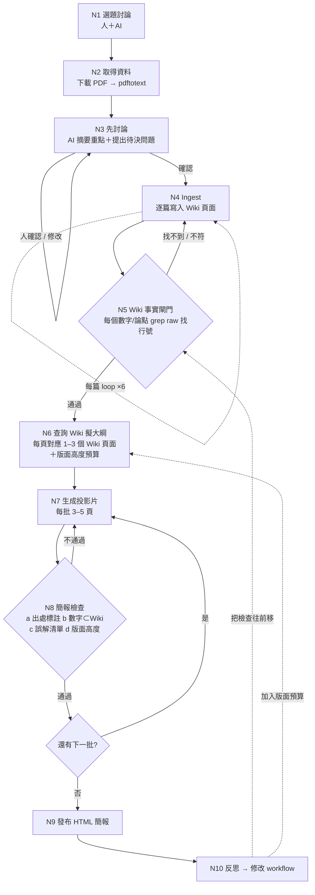

# HW10：用 LLM Wiki 做一份教學 HTML 簡報

> 繳交標題格式：學校 學號 系級 姓名 NeRF/3DGS

---

## 1. LLM Wiki 主題與簡介

**主題：從照片到 3D 世界：NeRF 與 3D Gaussian Splatting**

這是我的研究主題。Wiki 整理「新視角合成」從 NeRF（2020）一路演進到 3DGS（2023）的核心概念。內容全部來自 6 篇 ingest 的論文，每個概念頁都標註來源論文與章節，用來生成簡報和做事實檢查。

| 項目 | 內容 |
|---|---|
| Ingest 資料 | 6 篇：COLMAP（CVPR'16）、NeRF（ECCV'20）、Plenoxels（CVPR'22）、Instant-NGP（SIGGRAPH'22）、3DGS（SIGGRAPH'23）、3DGS Survey（arXiv） |
| Wiki 規模 | 21 頁：6 個來源頁、11 個概念頁、1 個比較頁、1 份誤解檢查清單、index、log |
| 結構 | `raw/`（PDF 和抽出的文字）→ `wiki/sources/` → `wiki/concepts/` → `wiki/comparisons/`，加上 `wiki/misconceptions.md` |

**Wiki 連結：** [請填入：例如把 `wiki/` 推到 GitHub 後的連結]
**教學 HTML 簡報：** `slides/index.html`（單一 HTML 檔，可直接用瀏覽器開啟；連結：[請填入：例如 GitHub Pages 網址]）

---

## 2. Loop / Graph 設計

### 文字版
**取得資料 → 先討論 → 寫入 Wiki → 事實閘門 → 查詢 Wiki 擬大綱 → 分批生成投影片 → 簡報檢查 → 發布 → 反思**

| 節點 | 做什麼 | 輸入 → 輸出 |
|---|---|---|
| N2 取得資料 | 從 arXiv / CVF 下載 PDF，用 `pdftotext` 轉成文字 | URL → `raw/*.pdf`、`raw/*.txt` |
| N3 先討論 | AI 讀 abstract / method / limitation，列出各篇重點和 4 個待決問題 | raw → 討論稿，經人確認 |
| N4 Ingest | 每篇寫一個來源頁，並新增或更新概念頁（含 `[[連結]]`） | 討論結論 → `wiki/*.md` |
| N5 事實閘門 | 對每個數字和關鍵論點 grep 原文，記下行號 | wiki → 通過，或退回 N4 |
| N6 擬大綱 | 每頁投影片指定對應的 Wiki 頁面，並依 824px 可用高度估算版面 | wiki → 19 頁大綱 |
| N7 生成 | 每批 3–5 頁 HTML，頁尾標「Wiki：xxx.md ｜ 來源：論文章節」 | 大綱 → `slides/project/slides/*.html` |
| N8 檢查 | `tools/check_deck.py`：檢查出處、Wiki 連結、數字是否都在 Wiki 裡；再對照誤解清單，並估算版面高度 | 投影片 → 通過，或退回 N7 |

### 哪些步驟會重複執行？
1. **N3 先討論 ↔ 人**：每個待決問題都要人確認後才往下（這次有 4 題：公式要不要放、Mip-NeRF360 怎麼處理、比喻、誤解清單）。
2. **N4 Ingest**：每篇論文跑一次，共 6 次。後面的論文會回頭更新前面的概念頁，例如 Plenoxels 補充了 volume-rendering 頁。
3. **N4 ↔ N5**：寫入後驗證，不通過就退回修改那一頁。
4. **N7 ↔ N8**：每批投影片生成後立刻檢查，不通過就只重新生成那幾頁。

### 哪些地方需要檢查或重新生成？
| 檢查點 | 檢查內容 | 不通過時 |
|---|---|---|
| N5 | 數字和論點能否在 `raw/*.txt` 找到原文行號 | 修正 Wiki 頁，或標註「推導」 |
| N8-a/b | 每頁有沒有 Wiki 出處、引用的 Wiki 頁是否存在、數字是否都出現在 Wiki | 重新生成該頁 |
| N8-c | 是否違反 `misconceptions.md` 的 M1–M10 | 重新生成該頁 |
| N8-d | 內容高度是否超過 824px（1080 − 上下邊距） | 調整間距，或拆成兩頁 |

### 為什麼這樣設計？
- **以 Wiki 當作唯一的事實來源。** 簡報只能引用 Wiki，Wiki 只能引用 raw。這樣每一句都能往回追到論文的行號，也讓「Wiki 與簡報有明確對應」可以被驗證。
- **先討論、後生成。** 公式深度、未 ingest 資料的處理方式這類決定，需要人的判斷，應該在生成之前定案，不要生成之後才返工。
- **分批生成、立刻檢查。** 出錯時只需要重做一批，不用整份重來。
- **把誤解清單寫成 Wiki 頁。** 同一份清單同時是檢查器的規則，也是簡報裡小測驗的題目。

---

## 3. 一次實際執行的結果與檢查紀錄

完整紀錄見 `wiki/log.md`，摘要如下：

| # | 節點 | 發生什麼 | 處理 |
|---|---|---|---|
| 1 | N1 | AI 先提 RAG，使用者改選自己的研究主題 NeRF/3DGS | 重新提案 6 篇論文 |
| 2 | N2 | 6 篇 PDF 全部下載成功（1.8MB–45MB），轉成文字 | — |
| 3 | N3 | 提出 4 個待決問題 | 使用者決定：公式**要放**；Mip-NeRF360 只放比較表並註明出處；比喻 OK；誤解清單照提案 |
| 4 | N4→N5 | ⚠ 3DGS-30K 那一行（41m33s / 134fps / 734MB / 27.21）是**憑記憶寫的** | grep 原文 L434 驗證，數字正確，補上行號註記 |
| 5 | N5 | ⚠「3DGS 每個高斯有 48 個 SH 係數」原文沒有直接寫 | 改標註為「由 4 bands 推得」 |
| 6 | N5 | 其餘 10 類數字和論點 | ✅ 全部對到原文行號（見 log.md 表格） |
| 7 | N8-a/b | `check_deck.py` 跑 19 頁 | ✅ 19/19 都有出處、無失效連結、數字都在 Wiki 裡 |
| 8 | N8-d | ⚠ `gs-idea` 估算高度約 968px，超過 920px 上限；`vr-intuition` 約 905px，接近上限 | 縮小卡片內距和間距後重新生成 |
| 9 | N8-d | ⚠ 想用 headless Chrome 截圖做視覺預覽，但在這台機器上**沒有產生截圖** | 改用版面規格手動估算高度，並記錄下來，之後要補上可用的預覽工具 |

**最終成果：** 19 頁教學簡報，分 6 段（問題 → SfM → NeRF → 加速 → 3DGS → 比較與總結）。包含 2 個動畫示範（光線穿過霧的體渲染、高斯逐步加密）、1 頁進階公式、1 頁互動小測驗（點擊揭曉答案）。

---

## 4. 反思

### 哪一個節點最常出錯？
**N4「寫入 Wiki」裡的數字和細節，也就是 AI 自己很有把握的部分。**
- 3DGS Table 1 的 30K 那一行是我憑記憶填的。這次剛好正確，但它在當下**沒有任何出處**，如果錯了，會原封不動流進簡報的比較表。
- 「48 個 SH 係數」是推導出來的，不是原文。沒有檢查的話，會被當成論文寫的事實。
- 第二常出錯的是 **N7「生成投影片」的版面**。內容一多就超出 1080px 畫面，而且這種錯誤要到渲染時才看得出來。

### 發現問題後，把檢查往前移到哪一步？
| 原本 | 調整後 |
|---|---|
| Wiki 全部寫完後，才統一做事實檢查 | 移到 **N4 寫入的當下**：每個數字寫進 Wiki 之前，先 grep 到行號（log.md 的規則：「寫入 wiki 前，每個數字都要先有行號」） |
| 投影片全部生成後，才檢查版面 | 移到 **N6 擬大綱**：規劃每頁時就先算高度預算（標題 + 卡片 + 表格 ≤ 824px），超過就先拆頁 |
| 簡報最後才檢查數字 | 每批生成後馬上跑 `check_deck.py`，要求簡報的數字必須是 Wiki 數字的子集 |

### 有沒有因此修改 workflow / graph？為什麼？
**有，改了三處（流程圖中的虛線）：**
1. **在 N4 和 N6 之間加了 N5「事實閘門」**，並讓它和 N4 形成迴圈。原因：錯誤越晚發現，影響範圍越大。Wiki 的一個錯數字會擴散到多頁投影片和小測驗。
2. **N6 擬大綱加入版面預算。** 原因：版面溢出只能靠渲染發現，而這次的預覽工具剛好失效。事先估算比事後修補便宜。
3. **把 `misconceptions.md` 從「參考資料」升級成「檢查器的規則」。** 原因：讓檢查有明確、可重複的標準，而不是靠 AI 臨場判斷。這份清單也同時當作小測驗的題目，讓「教」和「檢查」用同一份知識。

**還沒解決：** `check_deck.py` 用子字串比對數字，「50」這類短數字幾乎一定會出現在 Wiki 某處，所以會漏判。下一版應該改成比對「數字加單位」（例如「523 MB」），並把視覺預覽換成可用的工具。
